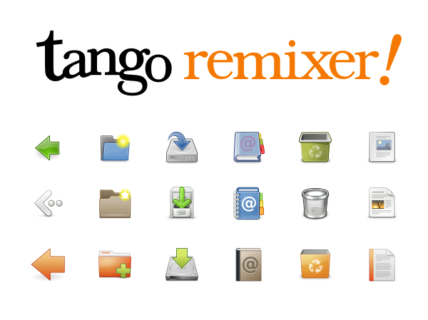

<div align="center">
  
</div>

# Tango Remixer

Remix multiple [Tango-flavoured icon themes](https://en.wikipedia.org/wiki/Tango_Desktop_Project) (e.g. Freedesktop Tango Icon Theme, GNOME Icon Theme, Ubuntu Humanity Icon Theme...etc) into an independent XDG-compatible icon theme pack, especially for Qt / GTK applications (e.g. directly retrieve icon via `QIcon::fromTheme(QString iconName)`)

This project is to convert it to `.qrc` which can be easily to be used in your Qt project. (only tested on Qt 6, mainly the HiDPI support.)

> **Table of Contents**
> - [Tango Remixer](#tango-remixer)
> - [Why](#why)
> - [Used Submodules / Thirdparties Tarballs](#used-submodules--thirdparties-tarballs)
> - [Built-in Icon Themes and Licenses](#built-in-icon-themes-and-licenses)
> - [How to Use in Qt Project?](#how-to-use-in-qt-project)
> - [Build .svg and .qrc](#build-svg-and-qrc)
> - [Internal Concepts](#internal-concepts)
> - [Acknowledgments](#acknowledgments)
> - [License](#license)

# Why

I personally strongly believe that **flat design + monotone icon since the 2010s is completely a disastrous regression in the field of UI/UX designing**, at least for me who am somewhat dyslexia and rely on colorful and distinguishing icon. The monotone icons in UI **significantly** decrease my reaction speed when interacting with an UI.

So when I need to add icons into a GUI application (ex: Qt), I always perfer my favorite icon style [Freedesktop's Tango Desktop](https://en.wikipedia.org/wiki/Tango_Desktop_Project) (precisely, it's [a style guidelines for icons](https://web.archive.org/web/20070314003622/http://tango.freedesktop.org/Tango_Icon_Theme_Guidelines), along with an official reference implementation including a very limited amounts of icons), I adore its reasonable, practical, aesthetic, elegant, and distinguishing on screen.

However, Tango Desktop Project has already discontinued and seems not to be promoted anymore ([official site](http://tango.freedesktop.org/Tango_Desktop_Project) has been down... an archive in [2007](https://web.archive.org/web/20070314003558/http://tango.freedesktop.org/Tango_Desktop_Project) and [2021](https://web.archive.org/web/20211002063126/http://tango.freedesktop.org/Tango_Desktop_Project)), and itself contains only a very limited amounts of icons which are hardly able to satisfy the requirements of desktop application development.

> Nowadays, it seems that the original version of tango-icon is only available on some places like distros' official package repository (e.g. [Archlinux](https://aur.archlinux.org/packages/tango-icon-theme))

Fortuantely, Canonical / Ubuntu followed Tango Style Guidelines and created [Humanity](https://launchpad.net/humanity/) Project for their Ubuntu GNOME desktop, maybe in around 2006, which provides a larger amount of icons for daily usage. So I hereby express my highest respect for their work.

# Used Submodules / Thirdparties Tarballs
This project relys on Ubuntu Humanity, and `./build_icons.py` will automatically download these tarballs. So you don't need to download these files manually.

## Tango Icon Theme
- **submodules/[tango-icon-theme](https://github.com/kuanyui/tango-icon-theme)**
  - A fork of **Freefesktop**'s **authentic** Tango Icon Theme; which is the official reference implementation of [Tango Icon Theme Guidelines](https://web.archive.org/web/20070314003622/http://tango.freedesktop.org/Tango_Icon_Theme_Guidelines).
  - License: GPL v3 or GPL v2

## Nome Icon Theme
- **submodules/[nome-icon-theme](https://github.com/kuanyui/nome-icon-theme)**
  - A fork of GNOME 2/3 default XDG icon theme, provided as SVG files. Includes some fixes and new extra icons.
  - License: LGPL v3 / CC by-sa 3.0

<!--
- thirdparty/[gnome-icon-theme-2.20.0.tar.bz2](https://download.gnome.org/sources/gnome-icon-theme/2.20/gnome-icon-theme-2.20.0.tar.bz2)
  - Downloaded from [download.gnome.org](https://download.gnome.org/sources/gnome-icon-theme/2.20/)
  - (Found in [Wikimedia](https://commons.wikimedia.org/wiki/GNOME_Desktop_icons), **but all icons are in PNG only, except 48x48 are in SVG.**)

- thirdparty/[gnome-icon-theme-2.91.93.tar.gz](https://download.gnome.org/sources/gnome-icon-theme/2.91/gnome-icon-theme-2.91.93.tar.bz2)
  - Downloaded from [download.gnome.org](https://download.gnome.org/sources/gnome-icon-theme/2.91/)
  - Started from this version, it provides variable sizes, but all sizes of each icons are drawn in the same SVG file... need extra process to extract them...

- thirdparty/[gnome-icon-theme-3.9.5.tar.xz](https://download.gnome.org/sources/gnome-icon-theme/3.9/gnome-icon-theme-3.9.5.tar.xz)
  - Downloaded from [download.gnome.org](https://download.gnome.org/sources/gnome-icon-theme/3.9/)

- thirdparty/[gnome-icon-theme-3.12.0.tar.xz](https://download.gnome.org/sources/gnome-icon-theme/3.12/gnome-icon-theme-3.12.0.tar.xz)
  - Seems to be the last version of `gnome-icon-theme`.
  - Downloaded from [download.gnome.org](https://download.gnome.org/sources/gnome-icon-theme/3.12/)

- thirdparty/[gnome-icon-theme-extras](https://gitlab.gnome.org/Archive/gnome-icon-theme-extras)
  - Totally unused. For reference only.
  - Dwonloaded from [gitlat.gnome.org](https://gitlab.gnome.org/Archive/gnome-icon-theme-extras)
-->

## Ubuntu Humanity
- **submodules/[humanity-icon-theme](https://github.com/kuanyui/humanity-icon-theme)**
  - A fork of Ubuntu's Humanity Icon Theme (migrated from Launchpad Bazzar repository), provided as SVG files. May includes some fixes and new extra icons.
  - License: Some are GPL, some are Public Domain

<!--
- thirdparty/[humanity_0.4.6.tar.gz](https://launchpad.net/humanity/0.4/0.4/+download/humanity_0.4.6.tar.gz)
  - **The only tarball which is being processed by our script.**
  - Clone from [Humanity official launchpad repo](https://launchpad.net/humanity/+download). (I guess this would be the last version after all...)
  - License: GPLv2
-->

## FLOSS Icon Collections
- **submodules/[floss-icon-collections](https://github.com/kuanyui/floss-icon-collections)**
  - Icons collected from the source code of some FLOSS projects:
    - GIMP: `GimpLegacy` (GPL v3+, licensed the same as GIMP application core)
    - GIMP: `GimpDefault` (CC by-sa 3.0)
    - Inkscape: `InkscapeTango` (GPL v2)


# Built-in Icon Themes and Licenses

> [!CAUTION]
> This project merely a tool for developer, aimes to simplify the process of picking icons from multiple XDG-compatible icon themes, mixing and aggregating them into a new XDG-compatible icon theme. But for the final project you are about to create, license compatibility must to be checked:
>
> ### (L)GPL Compatibility
> - Be careful, (L)GPL **v2** are **not compatible** with (L)GPL **v3**. You should **not** aggregate them together as derivated work.
> - But (L)GPL licenses with **same version number** are compatible. That is, GPL v3 is compatible with LGPL v3. GPL v2 is compatible with LGPL v2.
>
> ### TL; DR
> - If you are going to use these icons in a Qt project, Qt community version allows LGPLv3 or GPLv3 only, so you should **never** use **any** GPL v2 icon in it.
> - If you are going to use these icons in a GTK project, GTK itself is licensed under LGPL v2.1+, so you can choose either GPL v2 or v3 according to the license of your project. **but** still should **never** mix v2 and v3 together.
> - LGPL is with lesser restriction, you should can embed LGPL icons statically into your executable, as long as you provide all source code or object file which can be linked.

| Theme ID        | Forked Source | License                                                        | Description                                                                                                                 |
|-----------------|---------------|----------------------------------------------------------------|-----------------------------------------------------------------------------------------------------------------------------|
| `Tango`         | Tango         | `GPL v2` or `GPL v3`                                           | Tango Icons from Freedesktop.org, See [tango-icon-theme](https://github.com/kuanyui/tango-icon-theme)                       |
| `Nome`          | GNOME         | `LGPL v3` or `CC by-sa 3.0`                                    | See [nome-icon-theme](https://github.com/kuanyui/nome-icon-theme)                                                           |
| `BlueNome`      | GNOME         | `LGPL v3` or `CC by-sa 3.0`                                    | (⇧ Same with `Nome`, but with adjusted hue by Python script in this project)                                                |
| `Humanity`      | Ubuntu        | Depends (some icons are `GPL`, while some are `Public Domain`) | The license declaration is ambigious, please judge according to the descriptions in its `COPYING` file                      |
| `BlueHumanity`  | Ubuntu        | Depends (some icons are `GPL`, while some are `Public Domain`) | (⇧ Same with `Humanity`, but with adjusted hue by Python script in this project)                                            |
| `GimpLegacy`    | GIMP          | `GPL v3+`                                                      |                                                                                                                             |
| `GimpDefault`   | GIMP          | `CC by-sa 3.0`                                                 | This license is actually somewhat unreasonable, because **the compatibility between `GPL` and `CC by-sa`is controversial**. |
| `InkscapeTango` | Inkscape      | `GPL v2`                                                       |                                                                                                                             |

# How to Use in Qt Project?

> [!IMPORTANT]
> Run `./build_icons.py --help` for more latest information and full usages.

## 1. Clone this project into `MY_QT_PROJ/resources/`
```
git clone --recursive git@github.com:kuanyui/tango-remixer.git
```

## 2. Specify wanted icons via `included_icons.txt`

`cd` into `MY_QT_PROJ/resources` and create `included_icons.txt`, then specify the required icons in following format:

> ```
> SRC_THEME_NAME    [SRC_CONTEXT/]SRC_ICON_NAME    [DST_CONTEXT/]DST_ICON_NAME    [{SIZE_MATRIX}]
> SRC_THEME_NAME    [SRC_CONTEXT/]SRC_ICON_NAME    [DST_CONTEXT/]DST_ICON_NAME
> SRC_THEME_NAME    [SRC_CONTEXT/]SRC_ICON_NAME    [{SIZE_MATRIX}]
> SRC_THEME_NAME    [SRC_CONTEXT/]SRC_ICON_NAME
> ```
>
- Separate fields by tab, or >=4 spaces.
- `SRC_CONTEXT` is unused currently. Can be omitted.
- `SRC_ICON_NAME` is required. Should not contain the extension. All extensions will be ignored.
- `DST_CONTEXT` is optional. Default is same with the context of the source icon.
- `DST_ICON_NAME` is optional, which can be used to rename the outputted icon name.
- All `*_ICON_NAME` should not contain the extension. All extensions will be ignored.
- `{SIZE_MATRIX}` is optional. Restricts which input sizes are picked / how they map to output sizes. If omitted, all available source sizes are used. Segments separated by `;`. Each segment is one of:

  | Segment    | Expression    | Expression Meaning                              | Other Equivalents                              |
  |------------|---------------|-------------------------------------------------|------------------------------------------------|
  | **single** | `16`          | pick `16` in source, and output same size `16`. | `16>16`                                        |
  | **range**  | `16-32`       | pick every available size in the range .        | `16;22;24;32`, `16>16;22>22;24>24;32>32`       |
  |            | `-32`         | Open ranges, means "min size ~ `32`"            | `8;16;22;24;32`, `8>8;16>16;22>22;24>24;32>32` |
  |            | `32-`         | Open ranges, means "`32` ~ max size"            | (Too long, omitted.)                           |
  | **resize** | `16>32`       | take source size `16` and output as size `32`.  | (None)                                         |
  |            | `scalable>48` | rasterize the SVG source at size `48`.          | (None)                                         |

  - Example: `{16;22-48;scalable>64}` = single `16`, range `22..48`, plus scalable rasterized to `64`.
  - Note: If you pick `{22-48}`, but `32` is not found in icon theme, the `32` will be just ignored.
  - `scalable` is only valid as a resize input (`scalable>N`). `{scalable}`, `{N>scalable}`, and ranges with `scalable` are rejected.

For example:
```py
# Line started with `#` will be seen as comment and be ignored.

# Include the icon named `application-exit` in icon theme `Nome`.
Nome     application-exit

# Include the icon named `preferences-desktop-theme` in icon theme `Nome`, and rename it in our outputted new icon theme.
Nome     preferences-desktop-theme      apps/palettes

# The following two lines have same meaning. (`devices` is context, can be omitted.)
Nome     devices/computer
Nome     computer

# Include the icon named `folder`, `folder-open`, `folder-new` in icon theme `Tango`.
Tango    folder
Tango    folder-open
Tango    folder-new

# ======================================================
# Restrict / convert sizes via the {SIZE_MATRIX} field
# ======================================================

# Only build sizes 16, 22, and 48 of this icon (skip 24, 32, ...).
Tango    folder    {16;22;48}

# Include every source size in range 16..48 (each maps to itself).
Tango    folder-open    {16-48}

# Open range: from the smallest available size up to 48.
Tango    document-save    {-48}

# Take the scalable source and rasterize it as size 64.
Tango    document-open    {scalable>64}

# Resize: take the 16-size source and output it as 32.
Tango    go-up    {16>32}

# Mix: single + range + scalable->fixed, separated by `;`.
Tango    user-home    {16;22-48;scalable>64}

# Rename + size matrix combined.
Tango    folder    folder-blue    {16;22;48}
```

> [!NOTE]
> Then you can test your `included_icons.txt` like this:
> ```sh
> ./tango-remixer/build_icons.py --included-icon-file ./included_icons.txt --output-theme-name "CustomizedTango"
> ```
> The built SVG and PNG files can be found in `./tango-remixer/dist/`. PNG is recommended because Qt's SVG renderer is not very well... Some icons may unable to be rendered correctly.

### Add Extra XDG-Compatible SVG Icon Themes
You can add extra XDG-compatible SVG icon theme(s) two ways:

#### **A. CLI Flag**

Highest priority (over in-file directive). Good for ad-hoc / CI overrides.

**Syntax: `--extra-icon-theme "THEME_NAME:THEME_PATH"`**

```sh
--extra-icon-theme "MyIcon:./relative/path/to/my_icon_theme"
--extra-icon-theme "AnotherIcon:../relative/path/to/another_icon_theme"
--extra-icon-theme "YetAnotherIcon:C:/absolute/path/on/windows/yet_another_icon_theme"
```
>
#### **B. In-File Directive**
This is the recommended way -- self-describing, also **recognizable by the LSP server**.

**Syntax: `# @extra-icon-theme THEME_NAME THEME_PATH`**

```conf
# @extra-icon-theme MyIcon       ../appicons
# @extra-icon-theme AnotherIcon  /opt/themes/another
# @extra-icon-theme YetAnotherIcon  C:/absolute/path/on/windows/yet_another_icon_theme
Tango    document-save
MyIcon   my-custom-thing
```

> [!IMPORTANT]
> - Paths are forward-slash only (`/`) on all OS (fuck disastrous Windows paths resolve rule). Backslashes are rejected.
> - Relative paths resolve based on `included_icons.txt`'s directory (**not** CWD).
> - `THEME_NAME` must match `[A-Za-z0-9_-]+`. Built-in theme names are reserved. Duplicate `THEME_NAME`s are rejected.
> - `THEME_PATH` may contain inner whitespace (but not recommended); trailing whitespace is trimmed.
> - If the same `THEME_NAME` appears in both CLI flag `--extra-icon-theme` and directive `# @extra-icon-theme`, the CLI flag's PATH **fully replaces** the directive's -- the directive's path is ignored entirely (**not** merged or searched as a fallback).
> - Build fails hard if a directive's path doesn't exist. The LSP only warns (so you can edit without triggering errors).

## 3. Edit `CMakeLists.txt`, watch the changes of `included_icons.txt` and build the included icons
### Way 1: Use an extra "Stamp File" to track fresh / stale state
```cmake
# ===============================================
# Build Icons
# ===============================================
find_package(Python3 REQUIRED Interpreter)

set(PROJ_GENERATED_DIR "${CMAKE_SOURCE_DIR}/generated" CACHE PATH
    "Directory for generated, platform independent files (e.g. XDG icon theme, changelogs...etc)")

set(RESOURCES_DIR "${CMAKE_SOURCE_DIR}/resources")
set(ICON_REPO_DIR "${CMAKE_SOURCE_DIR}/resources/tango-remixer")
set(ICON_BUILD_SCRIPT "${ICON_REPO_DIR}/build_icons.py")
set(ICON_THEME_NAME "CustomizedTango")
set(ICON_PNG_XDG_THEME_DIR "${PROJ_GENERATED_DIR}/icon_theme__png/${ICON_THEME_NAME}")
set(ICON_SVG_XDG_THEME_DIR "${PROJ_GENERATED_DIR}/icon_theme__svg/${ICON_THEME_NAME}")

# When included_icons.txt changed, auto execute cmake again.
set(ICON_INCLUDE_FILE "${RESOURCES_DIR}/included_icons.txt")
set(ICON_GENERATED_STAMP_FILE "${RESOURCES_DIR}/icons_built.stamp")
message(STATUS "STAMP ============================+> ${ICON_GENERATED_STAMP_FILE}")

# If qrc does not exist, create empty placeholder
set(ICON_PNG_GENERATED_QRC "${ICON_PNG_XDG_THEME_DIR}/index.qrc")
if(NOT EXISTS ${ICON_PNG_GENERATED_QRC})
    file(WRITE ${ICON_PNG_GENERATED_QRC} "<RCC>\n</RCC>\n")
endif()

add_custom_command(
    OUTPUT ${ICON_GENERATED_STAMP_FILE}
    COMMAND ${Python3_EXECUTABLE} ${ICON_BUILD_SCRIPT}
            --included-icon-file "${RESOURCES_DIR}/included_icons.txt"
            --extra-icon-theme "AppIcon:${RESOURCES_DIR}/appicon"
            --output-theme-name "${ICON_THEME_NAME}"
            --output-png-theme-to-dir "${ICON_PNG_XDG_THEME_DIR}"
            --output-svg-theme-to-dir "${ICON_SVG_XDG_THEME_DIR}"
    COMMAND ${CMAKE_COMMAND} -E touch ${ICON_GENERATED_STAMP_FILE}
    DEPENDS ${ICON_INCLUDE_FILE}
    COMMENT "Generating icon pack..."
    USES_TERMINAL    # immediately output
)
add_custom_target(icontheme DEPENDS ${ICON_GENERATED_STAMP_FILE})


# ==============================================
# Main
# ==============================================
qt_add_executable(myprojectname
     MANUAL_FINALIZATION
     ${PROJECT_SOURCES}
     ${ICON_PNG_GENERATED_QRC}

add_dependencies(myprojectname icontheme)
```

### Way 2: Brute Method (Always execute the build script after `cmake`)
```cmake
# ===============================================
# Build Icons
# ===============================================
find_package(Python3 REQUIRED Interpreter)
set(RESOURCES_DIR "${CMAKE_SOURCE_DIR}/resources")
set(ICON_REPO_DIR "${CMAKE_SOURCE_DIR}/resources/tango-remixer")
set(ICON_BUILD_SCRIPT "${ICON_REPO_DIR}/build_icons.py")
execute_process(
    COMMAND ${Python3_EXECUTABLE} ${ICON_BUILD_SCRIPT} --included-icon-file "${RESOURCES_DIR}/included_icons.txt" --output-theme-name "CustomizedTango"
)
set_property(
    DIRECTORY APPEND PROPERTY CMAKE_CONFIGURE_DEPENDS "${RESOURCES_DIR}/included_icons.txt"
)

# ==============================================
# Main
# ==============================================
qt_add_executable(myprojectname
     MANUAL_FINALIZATION
     ${PROJECT_SOURCES}
     resources/tango-remixer/dist/04_FINAL_PNG_THEME/CustomizedTango/index.qrc
)

```
## 4. Use in Qt/C++

Now you can get `QIcon` via `QIcon::fromTheme()`. Setup `mainwindow.cpp` like this:

```cpp
    QIcon::setThemeSearchPaths({ ":/xdg_icon_themes" });   // this `:/xdg_icon_themes` is a `<qresource prefix>` defined in `qrc`
    QIcon::setThemeName("CustomizedTango");    // `--output-theme-name`
    setWindowIcon(QIcon::fromTheme("palettes"));    // The included icon name.
```
# Build .svg and .qrc
```sh
make build   # download tarballs & extract, then build .svg and .qrc into dist/
make clean   # delete dist/
make clean-tarballs    # delete all thirdparty tarballs (so that you can download again if you encountered fail)
python3 ./build_icons.py --help  # see other options
```

For how to use in Qt C++ project, see the following descriptions.

# Internal Concepts
> ## Specifications of XDG Icon Theme
> - https://specifications.freedesktop.org/icon-theme-spec/latest/
> - https://specifications.freedesktop.org/icon-naming-spec/icon-naming-spec-latest.html
>
> ### Other tutorials
> - https://openapplibrary.org/dev-tutorials/qt-icon-themes
>
> ## Terminology
> - `REPO` is this icon repo, that is, `tango-remixer/`

## About Qt 6 C++ API & Freedesktop Supports
Qt 6 follows freedesktop.org XDG's specifications and implement a cross-platform XDG icon theme support for Qt application. So you can use any icon theme pack which follows freedesktop.org standard in your Qt application and run on Linux / Mac / Windows.

Let me start with a simplest example. The directory structure of `humanity_0.4.6` looks like this:
```sh
# tree -F -L 3 --dirsfirst
./
└── humanity_0.4.6/
    ├── Humanity/
    │   ├── actions/
    │   ├── animations/
    │   ├── apps/
    │   ├── categories/
    │   ├── devices/
    │   ├── emblems/
    │   ├── mimes/
    │   ├── places/
    │   ├── status/
    │   ├── stock/
    │   ├── AUTHORS
    │   ├── COPYING
    │   └── index.theme      # <- Must be included in .qrc, so that become accessible via C++ API.
    └── Humanity-Dark/
        ├── actions/
        ├── apps/
        ├── devices/
        ├── status/
        ├── AUTHORS
        ├── COPYING
        └── index.theme
```

Then write a simplest workable example like this:

```xml
<!DOCTYPE RCC>
<RCC version="1.0">
    <qresource prefix="/">
        <file>thirdparty/humanity_0.4.6/Humanity/index.theme</file>
        <file>thirdparty/humanity_0.4.6/Humanity/apps/24/totem.svg</file>
        <file>thirdparty/humanity_0.4.6/Humanity/apps/48/totem.svg</file>
    </qresource>
</RCC>
```

- Specify icon theme folder search paths; Qt will try to search all icon theme folder(s) contining `index.theme` in this path `:/thirdparty/humanity_0.4.6/`:
```cpp
QIcon::setThemeSearchPaths({ ":/thirdparty/humanity_0.4.6" });
```

- This is optional, for searching your other extra icons which are not included in the XDG icon theme:
```cpp
QIcon::setFallbackSearchPaths({ ":/MY_OTHER_ICON" });
```

- Specify a icon theme (the folder name seems have to be the same) under any of `QIcon::themeSearchPaths()` (:/src/humanity_0.4.6)
```cpp
QIcon::setThemeName("Humanity");
```

- Then `QIcon::fromTheme("ICON_NAME")` will automatically traverse across all folders, according to the difinition inside `Humanity/index.theme` and create a new `QIcon`.
```
setWindowIcon(QIcon::fromTheme("totem"));
```

## About Script: What On Earth Is This Script Doing?
```txt
{REPO}/thirdparty/humanity_0.4.6/Humanity/apps/24 $ ls -l

-rw-r--r-- 1 ono ono 19186 Dec  4  2009 totem.svg
lrwxrwxrwx 1 ono ono     9 Dec  4  2009 video-player.svg -> totem.svg

{REPO}/thirdparty/humanity_0.4.6/Humanity/apps/48 $ ls -l

-rw-r--r-- 1 ono ono 19186 Dec  4  2009 totem.svg
lrwxrwxrwx 1 ono ono     9 Dec  4  2009 video-player.svg -> totem.svg
```

So this script will copy the non-symlink files:

```
{REPO}/thirdparty/humanity_0.4.6/Humanity/apps/24/totem.svg
{REPO}/thirdparty/humanity_0.4.6/Humanity/apps/48/totem.svg
```

To folder (category like `apps`, `actions` are omitted):
```
{REPO}/dist/OurTango/apps/24/totem.svg
{REPO}/dist/OurTango/apps/48/totem.svg
```

But attention we need to follow the XDG standard, to fit the folder structure of `/usr/share/icons/hicolor`:

| Place | Folder Structure | Usage |
| --- | --- | --- |
| Source | `apps/16/` | Convenient for designer and maintainer (convension since SVN / CVS era) |
| `/usr/share/icons/hicolor` | `16x16/apps/` | The XDG standard directory structure in `/usr/share/icons/hicolor` (fallback icon theme of all icons) |
| `/usr/share/icons/hicolor` | `16x16@2/apps/` | The XDG standard directory structure in `/usr/share/icons/hicolor` (fallback icon theme of all icons) |
| `/usr/share/icons/breeze` | `apps/16` | Ehh... Not all icon theme pack follows the XDG's `hicolor` folder structure. This is a real example... (This project currently cannot output such directory structure.) |

### index.theme

`@2` and `Scale=2` `Size=32` is extra (but significant) definition. Qt / QIcon will handle these definitions to generate pixmap of corresponding sizes.

- It seems that `@2` suffix is merely a naming convention... but:
  > `QIcon` will use Qt's "@nx" high DPI syntax.
  > ([quoted from Qt official doc - QIcon](https://doc.qt.io/qt-6/qicon.html#high-dpi-icons))

  > **High Resolution Versions of Images**
  >
  > It is possible to provide high resolution versions of images should a scaling between device pixels and device independent pixels be in effect.
  >
  > The high resolution version is marked by the suffix `@2x` on the base name. The image read will have its device pixel ratio set to a value of 2.
  >
  > This can be disabled by setting the environment variable `QT_HIGHDPI_DISABLE_2X_IMAGE_LOADING`.
  > ([quoted from Qt official doc - QImageReader](https://doc.qt.io/qt-6/qimagereader.html#high-resolution-versions-of-images))

- `Scale=2` and `Size=32` is defined in [Freedesktop Icon Theme Specification](https://specifications.freedesktop.org/icon-theme-spec/latest/)

The `*.svg` files themselves already define the image size (via `<svg width="16" height="16">`.) So when you are using a HiDPI screen:

- If without `@2` in `index.theme`, Qt may select a (too sophisticated and complex) 32x32 icon and render + draw it directly in a 16x16 area.
- If without `Scale=2` and `Size=32`, Qt may select a 16x16 svg, render to a 16x16 pixmap cache, then draw on a 16x16 (actual physical pixel is 32x32) area... Yes, it blurred.

> I don't sure the detailed implementation of `@2` or `@2x` naming convention in Qt... And don't want to do more experiments for it neither. After all, I think the way Humanity did should be "standard enough".

```conf
[Icon Theme]
Name=Tango
Comment=Smooth modern theme designed to be intuitive.
Inherits=gnome,hicolor

Example=directory-x-normal

# Directory list (includes extra definition for HiDPI)
Directories=apps/16,apps/48,apps/16@2,apps/48@2

[apps/16]
Size=16
Context=Applications
Type=Fixed

[apps/48]
Size=48
Context=Applications
Type=Fixed

# Following are definition for `{context}/{size}@2`
#
# (Actually, the path `apps/16@2/` is not existed in real file system,
# but it is defined in our .qrc via <file alias="apps/16@2/..."> and
# accessible in Qt, just like a virtual file system.)

# 16 * 2 = 32
[apps/16@2]
Size=32
Scale=2
Context=Applications
Type=Fixed

# 48 * 2 = 96
[apps/48@2]
Size=96
Scale=2
Context=Applications
Type=Fixed

```

### index.qrc
> You can see a QRC file description of a virtual file system inside a Qt application.

```xml
<!DOCTYPE RCC>
<RCC version="1.0">
    <qresource prefix="/xdg_icon_themes/Tango">
        <file>index.theme</file>
    </qresource>
    <qresource prefix="/xdg_icon_themes/Tango">
        <file alias="apps/24@2/totem.svg">apps/24/totem.svg</file>
        <file alias="apps/24@2/video-player.svg">apps/24/totem.svg</file>
    </qresource>
    <qresource prefix="/xdg_icon_themes/Tango">
        <file alias="apps/48@2/totem.svg">light/48/totem.svg</file>
        <file alias="apps/48@2/video-player.svg">light/48/totem.svg</file>
    </qresource>
</RCC>
```

### Usage in C++
- CMakeLists
```cmakelists
    qt_add_executable(qkiss
        MANUAL_FINALIZATION
        ${PROJECT_SOURCES}
        resources/tango_icons_for_qt/dist/Tango/index.qrc
    )
```

- mainwindow.cpp
```cpp
    QIcon::setThemeSearchPaths({ ":/xdg_icon_themes" });
    QIcon::setThemeName("Tango");
    setWindowIcon(QIcon::fromTheme("paprefs"));
```

> Note of qrc:
>   - `RCC > qresource[prefix]` is not related to the real folder structure. It is only used in Qt for the resource path.
>      - **Totally unrelated** to the real file path. (`<file>`)
>      - I mean, this is unable to shorten the content of `<file>`. This is merely an "prepended extra namespace".
>      - It effects the path when refer resource file in C++. To refer a resource file in C++, the path would be:
>        - `:/{prefix}/{file}`
>        - `:/{prefix}/{file_alias}`
>   - `RCC > qresource > file[alias]` is used in Qt for the resource path only.
>   - `RCC > qresource > file`'s content is **ALWAYS** and **ONLY CAN BE** the file path **relative to** this `qrc` file.
>
> Now import `dist/tango_icons.qrc` in your Qt project,
> you can access the icon in Qt by `:/tango_icons/light/48/video-player.svg`,
> it will become `dist/tango_icons/light/48/totem.svg` in the real file system.

As a reference, the final file-system structure looks like:

# Acknowledgments
> [!WARNING]
> ## Disclosures of LLM Usage
> This project's Python scripts partially rely on LLM, including:
> - **Core features**: about ~20% of codebase, mainly for scaffold / boilerplate code, Python API. With human being fully-reviewed:
>   - ChatGPT (Web UI),
>   - Gemini (Web UI),
>   - Claude (Web UI),
>   - Claude Code (For debug... I've been burnt-out after release publicly; too lazy to debug manually.)
> - **LSP server** (and its docs): 100% were directly written by LLM agent (Claude Code). ~~I have no interest to spend my life time on this. After all I have no talents of writing code.~~
> - **Tests**: 99% were directly written by LLM agent (Claude Code), according to the documentations in code and my instructions. Roughly reviewed by human.
>
> All the other parts are done by human.

# License**s**

Source code, include this README, are released under GPLv3.

**For icons**, please read the `LICENSE` of each repo in `thirdparty/` and `submodules/`.
